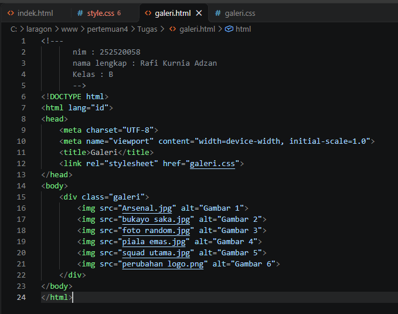
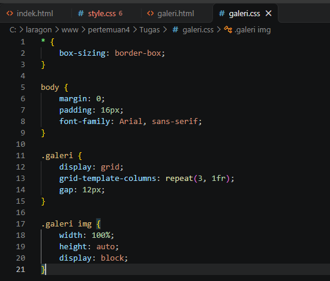
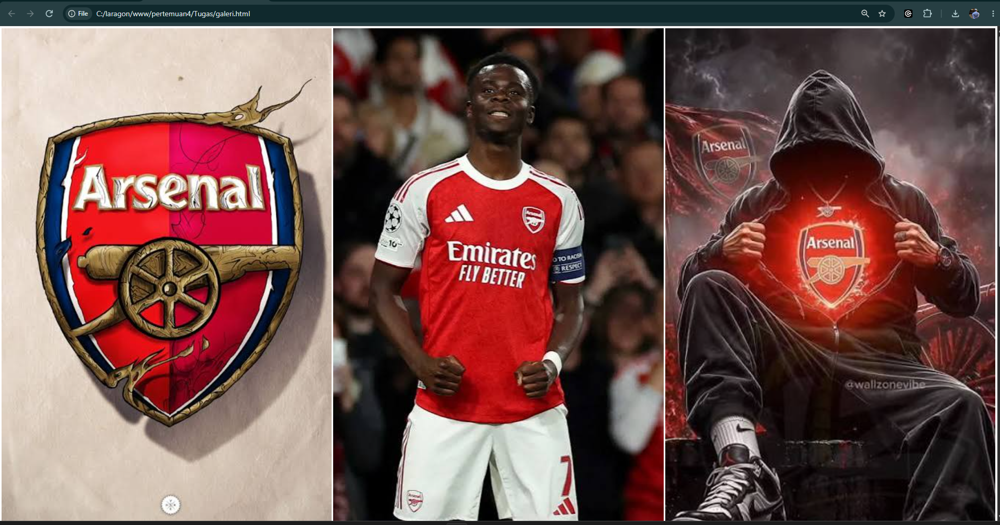
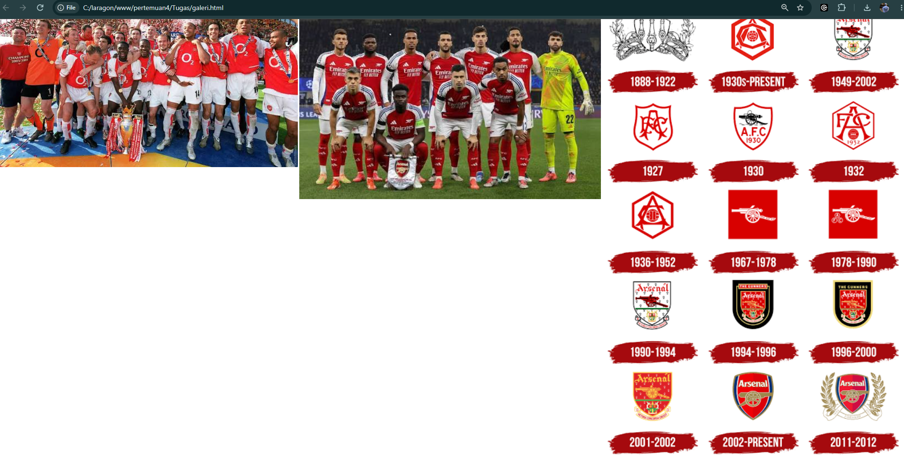
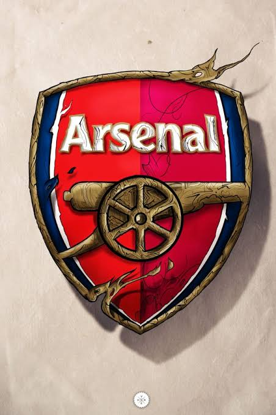
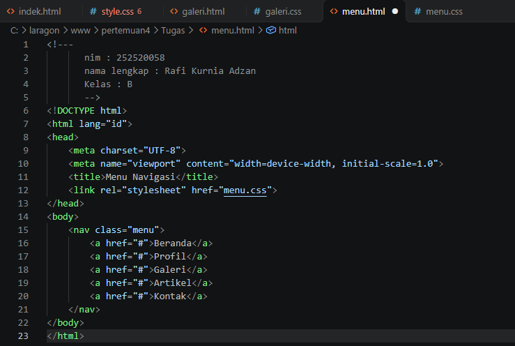
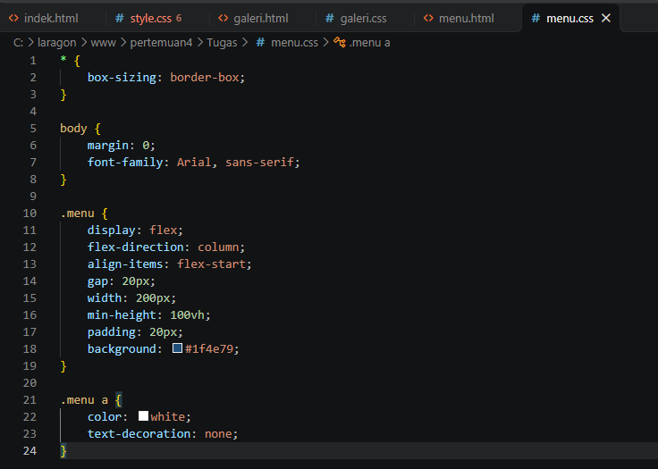
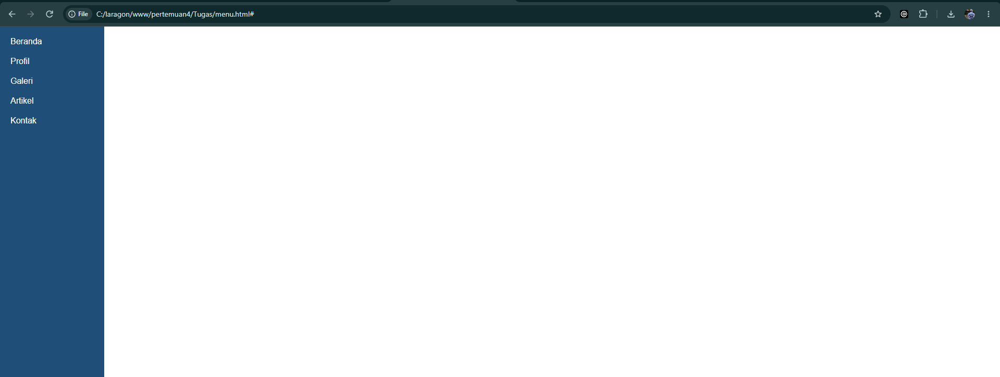

# Tugas Pemrograman Web Pertemuan 5

- Nama  : Rafi Kurnia Adzan
- NIM   : 252520058
- Kelas : B

---

## Soal 3a: Lebar total elemen

Diketahui: width 300px, padding 25px, border 5px.

**Pakai content-box (bawaan browser)**

Padding dan border ditambahkan di luar width, jadi rumusnya:

lebar total = width + padding (kiri + kanan) + border (kiri + kanan)

lebar total = 300 + (25 x 2) + (5 x 2) = 300 + 50 + 10 = **360px**

**Pakai border-box**

Kalau pakai border-box, padding dan border sudah dihitung di dalam width. Jadi lebar totalnya tetap **300px**, dan yang berkurang adalah ruang untuk isinya (300 - 50 - 10 = 240px).

---

## Soal 3b: Arti `grid-template-columns: repeat(4, 1fr)`

Kode ini artinya membuat grid dengan **4 kolom yang lebarnya sama besar**. Tulisan `repeat(4, 1fr)` sama saja dengan menulis `1fr 1fr 1fr 1fr`. Satuan `fr` itu bagian dari ruang yang tersedia, jadi tiap kolom dapat 1 bagian dari 4 bagian, atau sekitar 25% dari lebar container.

---

## Soal 3c: Perbedaan display block, inline, dan inline-block

- **block**: elemennya memenuhi satu baris penuh, jadi elemen berikutnya turun ke baris baru. Width dan height bisa diatur. Contohnya `div`, `p`, dan `h1`.
- **inline**: elemennya mengalir di samping teks dan hanya selebar isinya. Kalau diberi width dan height, tidak berpengaruh. Contohnya `span` dan `a`.
- **inline-block**: elemennya tetap sebaris seperti inline, tapi width dan height masih bisa diatur seperti block.

Contoh memakai satu elemen yang sama, yaitu `span`:

```html
<span class="kotak a">Kotak A</span>
<span class="kotak b">Kotak B</span>
<span class="kotak c">Kotak C</span>
```

```css
.kotak   { width: 100px; height: 50px; background: lightblue; }
.kotak.a { display: block; }        /* tiap kotak satu baris, ukuran 100x50 berlaku */
.kotak.b { display: inline; }       /* sebaris, ukuran 100x50 tidak berlaku */
.kotak.c { display: inline-block; } /* sebaris, ukuran 100x50 berlaku */
```

---

## Soal 3d: Galeri enam gambar dengan CSS Grid

### Screenshot kode





### Screenshot hasil di browser





### Kode program

`galeri.html`

```html
<div class="galeri">
    
    
    
    
    
    
</div>
```

`galeri.css`

```css
* { box-sizing: border-box; }

body { margin: 0; padding: 16px; font-family: Arial, sans-serif; }

.galeri {
    display: grid;
    grid-template-columns: repeat(3, 1fr);
    gap: 12px;
}

.galeri img {
    width: 100%;
    height: auto;
    display: block;
}
```

### Penjelasan kode

Di HTML, saya membuat sebuah `div` dengan class `galeri` yang berisi 6 gambar memakai tag `img`. Semua pengaturan tampilannya ada di file CSS:

- `display: grid` saya pakai di `.galeri` supaya div tersebut menjadi grid, dan 6 gambar di dalamnya otomatis menjadi item grid.
- `grid-template-columns: repeat(3, 1fr)` membuat 3 kolom dengan lebar yang sama. Karena ada 6 gambar, hasilnya jadi 2 baris dan 3 kolom.
- `gap: 12px` memberi jarak 12px antar gambar, baik ke samping maupun ke bawah.
- `width: 100%` membuat gambar mengikuti lebar kolomnya, dan `height: auto` membuat tingginya menyesuaikan supaya gambar tidak gepeng. Dengan begitu gambar tidak keluar dari kolom.
- `display: block` saya tambahkan di gambar supaya tidak ada celah kecil di bawah gambar, karena gambar aslinya bersifat inline.
- `box-sizing: border-box` supaya padding dan border tidak membuat ukuran elemen jadi lebih besar dari yang diatur.

---

## Soal 3e: Menu navigasi vertikal dengan Flexbox

### Screenshot kode





### Screenshot hasil di browser



### Kode program

`menu.html`

```html
<nav class="menu">
    <a href="#">Beranda</a>
    <a href="#">Profil</a>
    <a href="#">Galeri</a>
    <a href="#">Artikel</a>
    <a href="#">Kontak</a>
</nav>
```

`menu.css`

```css
* { box-sizing: border-box; }

body { margin: 0; font-family: Arial, sans-serif; }

.menu {
    display: flex;
    flex-direction: column;
    align-items: flex-start;
    gap: 20px;
    width: 200px;
    min-height: 100vh;
    padding: 20px;
    background: #1f4e79;
}

.menu a {
    color: white;
    text-decoration: none;
}
```

### Penjelasan kode

Di HTML, saya memakai tag `nav` dengan class `menu` yang berisi 5 tautan: Beranda, Profil, Galeri, Artikel, dan Kontak. Penjelasan bagian CSS-nya:

- `display: flex` membuat `.menu` menjadi Flexbox, jadi 5 tautan di dalamnya menjadi item flex.
- `flex-direction: column` mengubah arah susunan dari ke samping (bawaan) menjadi ke bawah, sehingga tautan tersusun menurun.
- `align-items: flex-start` membuat tautan rata kiri. Karena arahnya column, sumbu silangnya horizontal, jadi `flex-start` berarti di sisi kiri.
- `gap: 20px` memberi jarak 20px antar tautan sesuai soal.
- `width: 200px` dan `min-height: 100vh` membuat menu menjadi panel di sisi kiri halaman yang tingginya minimal setinggi layar.
- `padding: 20px` memberi ruang di dalam panel supaya tautan tidak menempel ke pinggir.
- `color: white` dan `text-decoration: none` membuat teks tautan berwarna putih tanpa garis bawah, supaya jelas terbaca di latar biru.
